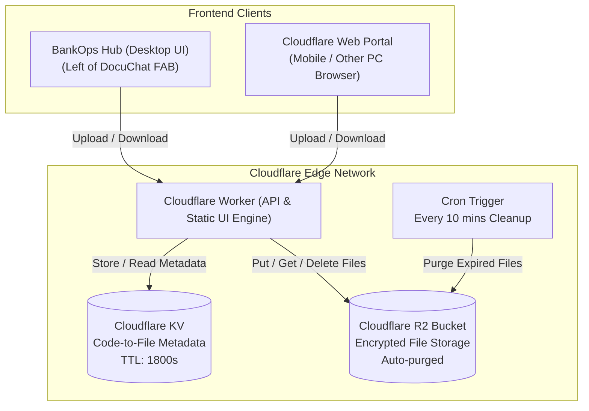
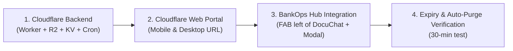

# 📋 Product Requirements Document (PRD)
## BankOps Hub — Ephemeral File Share Module (Cloudflare Powered)

**Feature Name:** BankOps Quick File Share (ক্লাউডফ্লেয়ার ফাইল শেয়ার)  
**Version:** 1.0  
**Date:** 2026-10-20  
**Owner:** Tanzil Ahmed (EID 7966) / BankOps Hub Team  
**Status:** In Review & Planning  

---

## 1. Executive Summary

### 1.1 Overview
BankOps Hub requires an ultra-fast, secure, and ephemeral file-sharing capability enabling branch officers to exchange documents (PDFs, images, Excel/Word sheets, scanned forms) seamlessly between:
1. **BankOps Hub Workstation ↔ Customer / Branch Mobile Phones**
2. **BankOps Hub Workstation ↔ Another Workstation / Colleague PC**

The system is powered by **Cloudflare** (Cloudflare Workers, Cloudflare R2 Object Storage, and Cloudflare KV) to provide global low-latency transfer, zero storage maintenance, ironclad 30-minute auto-expiry, and **100% Zero Cost (সম্পূর্ণ বিনামূল্যে $0.00 খরচে)** operating entirely within Cloudflare's generous perpetual free tiers.

### 1.2 Core Pillars
* **Dual-Interface Access:**
  - **Embedded Hub UI:** Located directly on the **left side of the DocuChat button** inside `BankOps Hub.html`.
  - **Standalone Cloudflare Web URL:** A clean, responsive web application hosted on Cloudflare where users (e.g., mobile users or remote PCs) can send and receive files without opening BankOps Hub.
* **4-Digit Easy Code (৪ সংখ্যার কোড):** Files are linked to a memorable 4-digit numeric code (e.g. `4829`, `1052`) for effortless manual entry or QR scan.
* **Strict 30-Minute Auto-Purge (৩০ মিনিট পর স্থায়ী ডিলিট):** Files exist for **strictly 30 minutes**. Once expired, both metadata and physical files are completely purged from Cloudflare servers.

---

## 2. Problem Statement & User Personas

### 2.1 Problem Statement
Branch banking staff frequently need to transfer customer documents (such as NID photos, tax certificates, trade licenses, utility bills) from a customer's smartphone or another desk to the BankOps Hub PC, or vice versa:
- WhatsApp Web / Personal emails on office PCs are often restricted or pose data privacy concerns.
- USB drives are blocked on secure banking workstations to prevent malware.
- Existing file sharing tools require login, accounts, or persistent cloud storage which violates banking data retention policies.

### 2.2 User Personas
| Persona | Need | Workflow |
|---|---|---|
| **Customer Service Officer (CSO)** | Receive customer's NID scan / e-TIN from smartphone | CSO opens File Share on BankOps Hub -> Shows 4-digit code / QR to customer -> Customer uploads via Cloudflare URL -> CSO downloads directly to BankOps Hub. |
| **Cash / Teller Officer** | Send denomination sheet or token file to supervisor | Teller uploads file in BankOps Hub -> Tells 4-digit code to Supervisor -> Supervisor enters code at their desk and gets file. |
| **Branch Manager** | Review prepared document from another terminal | Accesses via Cloudflare Web URL on tablet/laptop -> downloads file using 4-digit code. |

---

## 3. Key Feature Requirements

### 3.1 Hub Integration (UI Placement)
- **Position:** Fixed floating action button placed directly to the **left side of DocuChat FAB** at the bottom-right corner of BankOps Hub (`bottom: 24px; right: 96px;`).
- **Visuals:** Sleek floating button with a share/cloud icon and matching BankOps theme (smooth hover effect, tooltip: *"Quick File Share"*).
- **Interactive Modal / Drawer:**
  - **Header:** Title, status indicator, link to Cloudflare Web URL with copy button.
  - **Tab 1: 📤 Send File (ফাইল পাঠান)**
    - Drag & drop zone + browse button (supports all formats: PDF, JPEG, PNG, DOCX, XLSX, ZIP, Media, etc.).
    - **No File Size Limit (কোনো ফাইল সাইজ লিমিট নেই):** যেকোনো সাইজের ছোট বা বড় ফাইল কোনো কৃত্রিম সীমাবদ্ধতা ছাড়া আপলোড ও ট্রান্সফার করা যাবে।
    - **Chunked / Direct Stream Support:** বড় ফাইলের ক্ষেত্রে মেমোরি ড্রপ এড়াতে স্ট্রিম ভিত্তিক ট্রান্সফার।
    - Upon upload: Generates prominent **4-Digit Code** (e.g., `5 8 2 1`).
    - **One-click Copy Code** & **Copy Share Link**.
    - **QR Code generation** for instant mobile scanning (pointing directly to Cloudflare receive URL with code pre-filled).
    - **Live 30-Minute Countdown Timer** (e.g., `29:59` ticking down).
  - **Tab 2: 📥 Receive File (ফাইল গ্রহণ করুন)**
    - 4 individual digit input boxes (auto-advancing on typing, auto-paste support) or single formatted input.
    - "Fetch File" action with file metadata preview (Filename, File size, Time remaining).
    - "Download File" button to trigger instant direct download.

### 3.2 Cloudflare Standalone Web Portal
- Accessible via public Cloudflare Worker / Pages URL (e.g., `https://share.bankops.workers.dev` or custom branch domain).
- Fully mobile-responsive (PWA ready, touch-friendly UI).
- Same dual capability:
  - **Send:** Mobile user takes photo / selects document -> uploads -> receives 4-digit code.
  - **Receive:** Enter 4-digit code -> download to phone storage.

### 3.3 4-Digit Code System & Lifecycle
- Code range: `1000` to `9999` (or `0000` to `9999`, 4-digit padded).
- Uniqueness guarantee: The Cloudflare Worker checks KV if the code is currently active. If active, it generates a new code until an empty slot is found.
- Lifetime: Exactly **1800 seconds (30 minutes)** from the moment upload completes.
- Automatic Invalidation: After 30 minutes, looking up the code returns `404 Not Found / 410 Expired`.

### 3.4 Strict Server-Side Auto-Deletion (Data Expiry)
- **Zero Long-Term Storage Guarantee:**
  - Cloudflare KV keys are stored with `expirationTtl: 1800` (native KV TTL).
  - Cloudflare R2 object storage key is tied directly to the code/session ID.
  - **Immediate Expired Check:** If a user requests a file at `minute 31`, Worker rejects the download and immediately invokes `env.R2_BUCKET.delete(fileKey)`.
  - **Scheduled Cleanup (Cron Trigger):** A scheduled Cloudflare Worker runs periodically (e.g. every 10–15 minutes) to scan and clean up any orphaned or expired R2 objects whose TTL has lapsed.

---

## 4. 100% Free-of-Cost Guarantee (সম্পূর্ণ বিনামূল্যে আর্কিটেকচার)

এই পুরো সিস্টেমটি **ক্লাউডফ্লেয়ারের পার্মানেন্ট ফ্রি টিয়ারের (Perpetual Free Tier)** মধ্যে পরিচালিত হবে। এতে ১ পয়সাও বা ১ সেন্টও খরচ হবে না।

### 4.1 Cloudflare Free Tier Breakdown vs Usage Demand

| Service | Cloudflare Free Quota | BankOps Daily Usage Demand | Remaining Buffer | Cost |
|---|---|---|---|---|
| **Cloudflare Workers** | **100,000 requests / day** | ~100 to 500 requests / day | 99,500+ requests free | **$0.00 / ৳০** |
| **Cloudflare R2 Storage** | **10 GB-months / month**<br/>(1M Class A, 10M Class B) | Max ~100MB to 500MB at any given time (কারণ ৩০ মিনিট পর ফাইল মুছে যায়) | 9.5 GB buffer free | **$0.00 / ৳০** |
| **Egress / Bandwidth** | **Unlimited Free ($0 egress)** | ~1 GB - 5 GB / month | Unlimited | **$0.00 / ৳০** |
| **Cloudflare KV** | **100,000 reads / day**<br/>**1,000 writes / day** | ~50 - 200 writes / day | 800+ writes free | **$0.00 / ৳০** |
| **Domain / Hosting** | **Free `*.workers.dev` subdomain** | Provided out-of-the-box by Cloudflare | Included free | **$0.00 / ৳০** |
| **SSL / HTTPS** | **Free Cloudflare Universal SSL** | Automatic TLS 1.3 | Included free | **$0.00 / ৳০** |

### 4.2 কেন কোনো খরচ হবে না (Zero Cost Mechanism):
1. **স্বয়ংক্রিয় ৩০-মিনিট ডিলিট:** ফাইলগুলো স্থায়ীভাবে জমা হয় না। ৩০ মিনিট পর ডিলিট হয়ে যাওয়ায় স্টোরেজ সবসময় প্রায় ফাঁকা থাকে (১০ জিবি ফ্রি সীমার ১%-ও স্পর্শ করবে না)।
2. **জিরো এগগ্রেস ফি (Zero Egress Fees):** AWS S3 বা Google Cloud-এ ফাইল ডাউনলোড করলে ব্যান্ডউইথ খরচ হয়, কিন্তু ক্লাউডফ্লেয়ার R2-তে ডাউনলোড ব্যান্ডউইথ **সম্পূর্ণ ১০০% ফ্রি**।
3. **ফ্রি সাবডোমেন:** আলাদা কোনো ডোমেইন কেনার প্রয়োজন নেই—ক্লাউডফ্লেয়ারের ফ্রি `https://bankops-share.<your-subdomain>.workers.dev` সরাসরি ব্যবহার করা যাবে।
4. **নো ফাইল সাইজ লিমিট ও জিরো কস্ট সামঞ্জস্য (Zero-Cost Balance):**
   - কোনো কৃত্রিম ফাইল সাইজ লিমিট চাপানো হবে না।
   - ৩০ মিনিট শেষ হওয়ামাত্র স্বয়ংক্রিয়ভাবে সার্ভার থেকে ফাইল সম্পূর্ণ ডিলিট হয়ে যাওয়ার ফলে বড় ফাইল আপলোড করলেও ক্লাউডফ্লেয়ারের ১০ জিবি ফ্রি স্টোরেজ কোটার কোনো অপচয় হবে না।
   - অতিরিক্ত অপব্যবহার এড়াতে আইপি ভিত্তিক সাধারণ রিকোয়েস্ট রেট লিমিট থাকবে।

---

## 5. System Architecture & Tech Stack



### 4.1 Component Stack
| Component | Technology | Role |
|---|---|---|
| **Hub UI Integration** | HTML5, Vanilla CSS3, JavaScript | Floating action button next to DocuChat, responsive modal, QR generator, auto-countdown |
| **Edge Serverless Backend** | Cloudflare Workers | REST API endpoints for upload, metadata check, download, and file deletion |
| **Key-Value Store** | Cloudflare KV | Fast edge lookup of 4-digit codes, metadata storage, native 30-minute TTL expiry |
| **Object Storage** | Cloudflare R2 | S3-compatible, zero egress cost storage for binary files |
| **Auto Garbage Collection** | Cloudflare Cron Trigger | Periodic worker run to enforce complete deletion of expired files |
| **Standalone Web UI** | Cloudflare Pages / Worker Assets | Standalone responsive single-page web app for mobile/external devices |

---

## 5. API Endpoints Specification

| Method | Endpoint | Description | Request Payload | Response |
|---|---|---|---|---|
| `POST` | `/api/upload` | Upload new file | `multipart/form-data` (file, optional burnOnDownload) | `{ success: true, code: "4829", fileName: "...", fileSize: 1048576, expiresAt: 1729432800000, ttlSeconds: 1800 }` |
| `GET` | `/api/info/:code` | Retrieve file metadata before downloading | None | `{ success: true, fileName: "sample.pdf", fileSize: 1048576, mimeType: "application/pdf", expiresInSeconds: 1420 }` |
| `GET` | `/api/download/:code` | Download the binary file | None | Binary file stream with `Content-Disposition: attachment; filename="..."` |
| `DELETE`| `/api/delete/:code` | Early manual deletion by sender | None | `{ success: true, message: "File deleted successfully" }` |
| `GET` | `/*` | Serve standalone web UI | None | Responsive HTML/CSS/JS frontend |

---

## 6. Security, Compliance & Banking Standards

1. **Ephemerality & Zero Retention:**
   - Files are strictly non-recoverable after 30 minutes.
   - Prevents confidential banking and customer KYC documents from lingering in third-party clouds.
2. **Brute Force & Rate Limiting:**
   - Rate limiting on `/api/info` and `/api/download`: Maximum 5 failed code attempts per IP per minute to prevent 4-digit code guessing.
   - Optional: One-time download mode ("Burn after download" toggle) for sensitive documents.
3. **Transport Security:**
   - Forced HTTPS (TLS 1.3) with Cloudflare SSL certificate.
4. **Filename & Content Sanitization:**
   - File names are sanitized on upload to strip dangerous path characters (`../`, command injections, control characters).
   - Direct execution prevention: Cloudflare sends files with `Content-Disposition: attachment` and `X-Content-Type-Options: nosniff`.

---

## 7. UI / UX Design Specifications

### 7.1 BankOps Hub FAB Layout
```
+---------------------------------------------------------------------------------+
|                                                                                 |
|                            BankOps Hub Main Interface                           |
|                                                                                 |
|                                                                                 |
|                                                  [ 🔗 File Share ]  [ 💬 DocuChat ]|
|                                                     (right: 96px)      (right: 24px)|
+---------------------------------------------------------------------------------+
```

### 7.2 Send Workflow (Hub or Web Portal)
1. User clicks **"File Share"** button.
2. User selects or drops file (`NID_Front.jpg`).
3. System uploads file to Cloudflare R2 and KV.
4. Modal instantly displays:
   - Big Bold Code: **`4 8 2 9`** (with 📋 Copy button)
   - Dynamic QR Code (scannable by phone camera)
   - Expiration warning: `⏳ Available for 29:59 minutes. Auto-deletes afterwards.`
   - "Delete Now" button if user wants to destroy it prematurely.

### 7.3 Receive Workflow (Hub or Web Portal)
1. User clicks **"Receive File"** tab (or opens Cloudflare URL on phone).
2. User enters 4-digit code `4 8 2 9`.
3. System shows:
   - `📄 NID_Front.jpg (2.4 MB)`
   - `Expires in: 24 mins`
4. User clicks **"Download File"** -> File downloads directly to device.

---

## 8. Implementation Steps & Timeline



1. **Step 1: Cloudflare Infrastructure Setup**
   - Create Cloudflare Worker project (`fileshare/`).
   - Configure Cloudflare R2 Bucket (`bankops-fileshare`) & KV Namespace (`FILE_METADATA`).
   - Implement upload, download, metadata, and cron cleaner handlers.
2. **Step 2: Cloudflare Standalone Web Portal**
   - Design ultra-lightweight, high-performance HTML/CSS/JS frontend served directly by the Cloudflare Worker.
3. **Step 3: BankOps Hub Frontend UI Integration**
   - Add File Share FAB at `bottom: 24px; right: 96px;` inside `BankOps Hub.html`.
   - Add File Share Modal with Send/Receive tabs, 4-digit code display, QR code, and countdown timer.
   - Add Cloudflare Worker endpoint configuration in `config.js` or UI settings.
4. **Step 4: Quality Assurance & Security Validation**
   - Verify upload & download between desktop and mobile phone via Cloudflare URL.
   - Verify that at 30 minutes, code expires and file is deleted from Cloudflare R2.

---

## 9. Verification & Acceptance Criteria

- [ ] **100% Free of Cost:** Operates strictly within Cloudflare Free Tier ($0.00 / ৳০) without any paid services.
- [ ] **No File Size Limit:** কোনো ফাইল সাইজ লিমিট থাকবে না; ছোট-বড় যেকোনো সাইজের ফাইল অনায়াসে আপলোড/ডাউনলোড করা যাবে।
- [ ] **Placement:** File Share FAB is placed directly to the left of the DocuChat button in BankOps Hub.
- [ ] **Dual Access:** File can be sent from BankOps Hub and received via Cloudflare URL, or sent from Cloudflare URL and received in BankOps Hub.
- [ ] **4-Digit Code:** Every uploaded file gets a random 4-digit numeric code with zero active collision.
- [ ] **Strict 30-Min Expiry:** After 30 minutes, file cannot be downloaded and is permanently deleted from Cloudflare R2 & KV.
- [ ] **User Experience:** Sender sees countdown timer; receiver can input 4 digits easily with auto-focus.
